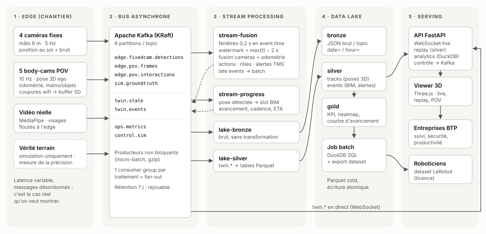

# ConStruct-AI — le jumeau numérique 4D des chantiers

> Des caméras sur le chantier → un replay 3D de **tout** ce qui s'y passe → des données
> de gestes humains vendues aux fabricants de robots pour leur apprendre le métier.

Projet Big Data ING3 (Baptiste & Maximilien). Le dépôt contient une **démo qui marche de bout en bout** :
chantier simulé, caméras fixes et body-cams avec réseau asynchrone, Kafka, traitement temps réel
avec watermark, data lake Parquet, analytics SQL, viewer 3D live/replay et export d'un dataset robotique.



---

## Lancer la démo

### Option 1 — un seul processus (pas besoin de Docker)

```bash
pip install -r requirements.txt
```

```bash
python -m construct_ai demo
```

Ouvrir **http://localhost:8000**. Le bus de messages tourne en mémoire, avec la même sémantique que Kafka
(un flux par consumer group, producteurs non bloquants).

### Option 2 — architecture distribuée avec Kafka (pour la soutenance)

```bash
docker compose up --build
```

* http://localhost:8000 : jumeau numérique (le badge en haut à droite affiche **APACHE KAFKA**)
* http://localhost:8080 : Kafka UI (topics, partitions, consumer groups, lag)

Quatre conteneurs : `kafka` (KRaft, sans ZooKeeper), `edge` (chantier + capteurs), `stream` (fusion + data lake),
`api` (WebSocket + viewer). On peut tuer et relancer `api` : il relit l'avancement depuis le data lake.

### Commandes utiles

| Commande | Rôle |
|---|---|
| `python -m construct_ai demo --speed 20` | tout-en-un, chantier accéléré x20 |
| `python -m construct_ai demo --bus kafka` | tout-en-un mais via un Kafka local (`docker compose up kafka`) |
| `python -m construct_ai edge \| stream \| api` | un micro-service seul (Kafka) |
| `python -m construct_ai gold` | job batch : tables gold Parquet + dataset robotique en `.zip` |
| `python -m construct_ai.vision.video_adapter --video chantier.mp4 --show` | brancher une **vraie vidéo** (MediaPipe, visages floutés) |
| `python -m pytest -q` | tests de bout en bout |

---

## Ce que montre la démo

| Dans l'interface | Ce qu'il y a derrière |
|---|---|
| Des ouvriers en squelette 3D qui montent une maison de 518 parpaings | Fusion des 4 caméras fixes et des 5 body-cams, fenêtre de 0,2 s en *event time* |
| « Rôles déduits par l'IA » : maçon, manœuvre, chef | Personne ne déclare son rôle : il est déduit du profil d'activité (100 % juste) |
| Action en cours (pose, mortier, brouette…) | Classifieur sur la pose 3D + les contacts main/objet : **~92 % de précision** mesurée contre la vérité terrain |
| Les parpaings apparaissent en jaune puis gris | Chaque pose détectée en POV est rattachée à son emplacement dans la maquette **BIM** |
| Panneau « Pipeline Big Data » | Débits par topic, messages arrivés dans le désordre, événements tardifs, watermark, fichiers Parquet |
| Timeline → **REPLAY** | Le chantier rejoué de A à Z depuis la couche *silver* du data lake (DuckDB) |
| Vue **POV** | La caméra se place sur le torse de l'ouvrier reconstruit |
| **Analytics** | Temps par activité, cadence de pose, distance parcourue, attente, alertes TMS |
| **Dataset robotique** | Épisodes au format LeRobot (Hugging Face) téléchargeables en `.zip` |

## Les concepts Big Data mis en œuvre

* **Volume / vélocité** : ~700 messages/s et ~350 Ko/s pour 5 ouvriers en x10. Un vrai chantier avec 20 ouvriers
  filmés en 1080p produit environ 300 Go de vidéo par jour (calcul dans [docs/ARCHITECTURE.md](docs/ARCHITECTURE.md)).
* **Variété** : détections caméra, poses 3D, odométrie, interactions objets, maquette BIM, vérité terrain.
* **Messagerie asynchrone** (Kafka) : producteurs et consommateurs découplés, un *consumer group* par traitement
  (`stream-fusion`, `stream-progress`, `lake-bronze`, `lake-silver`, `api-*`), partitionnement par capteur.
* **Event time vs processing time** : chaque capteur a sa latence, les body-cams perdent le wifi et renvoient leurs
  données en rafale (*store & forward*). La fusion range chaque message dans la fenêtre de **son instant de capture**
  et la ferme quand le **watermark** (`max(event_time) − 2 s`) la dépasse. Les retardataires partent en batch.
* **Architecture Lambda** : vitesse (stream, jumeau live) + batch (job gold sur tout l'historique, bronze complet).
* **Data lake médaillon** : bronze (brut JSON) → silver (trajectoires fusionnées) → gold (agrégats), en Parquet
  compressé zstd et partitionné `date=/hour=` (*partition pruning* pour le replay).
* **SQL analytique sur fichiers** : DuckDB interroge directement le lake (comme Spark SQL / Trino en production).
* **Confidentialité dès la conception** : la vidéo reste à l'edge, seuls des squelettes pseudonymisés circulent.

## Structure

```
construct_ai/
  config.py            paramètres + noms des topics
  bus.py               bus asynchrone : Kafka (aiokafka) ou mémoire, même API
  site/                maquette BIM, squelette 3D, navigation
  edge/                simulateur d'ouvriers + capteurs (latence, coupures wifi, occlusions)
  stream/              fusion event-time, reconnaissance d'activité, BIM matching, écriture du lake
  batch/               couche gold (DuckDB) + export du dataset robotique
  api/                 FastAPI : WebSocket live, replay, analytics, export, contrôle
  vision/              adaptateur vidéo réelle (MediaPipe)
web/                   viewer Three.js (aucune dépendance réseau : three.js est embarqué)
docs/                  pitch business, architecture, script de soutenance
tests/                 tests de bout en bout
```

## Documentation

* [docs/PITCH.md](docs/PITCH.md) : le produit, les clients, le modèle économique, le RGPD
* [docs/ARCHITECTURE.md](docs/ARCHITECTURE.md) : choix techniques, volumétrie, passage à l'échelle
* [docs/DEMO.md](docs/DEMO.md) : déroulé minute par minute de la démo en soutenance
