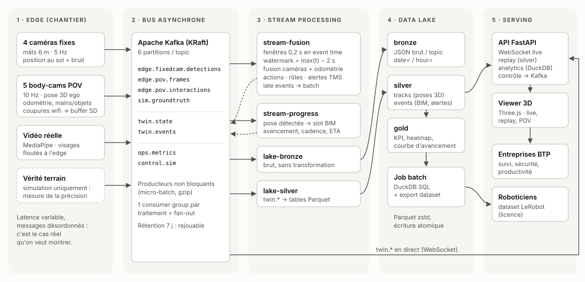

# Architecture technique



## 1. Flux et topics

| Topic | Producteur | Clé (partition) | Contenu | Débit (démo x10) |
|---|---|---|---|---|
| `edge.fixedcam.detections` | caméras fixes | id caméra | détections au sol (x, z, σ, badge casque) | ~200 msg/s |
| `edge.pov.frames` | body-cams | badge | pose 3D ego 15×3, cap IMU, odométrie, contacts mains | ~500 msg/s |
| `edge.pov.interactions` | body-cams | badge | prise/dépose de parpaing, livraison, mortier | ~5 msg/s |
| `sim.groundtruth` | simulateur | badge | vérité terrain (sert seulement à mesurer la précision) | 50 msg/s |
| `twin.state` | stream-fusion | site | état fusionné du jumeau (fenêtre de 0,2 s) | 50 msg/s |
| `twin.events` | stream-fusion / progress | badge | bloc posé (slot BIM), alerte TMS, anomalie | ~3 msg/s |
| `ops.metrics` | chaque service | service | métriques pipeline | 2 msg/s |
| `control.sim` | API | - | vitesse, pause | à la demande |

La clé de partition est l'identifiant de la source. L'ordre est donc garanti **par capteur**, et la fusion peut
se paralléliser par ouvrier en ajoutant des instances au consumer group.

## 2. Pourquoi c'est asynchrone et comment on le gère

Sur un vrai chantier, les messages n'arrivent **ni à l'heure ni dans l'ordre** :
* chaque capteur a sa propre fréquence et sa latence réseau (50 à 400 ms, avec des pics à 2 s) ;
* une body-cam qui perd le wifi **stocke** ses frames puis les renvoie **en rafale** plusieurs secondes plus
  tard (*store & forward*) ;
* les caméras fixes perdent de vue les ouvriers quand les murs montent (occlusion simulée).

Le simulateur reproduit tout cela (`edge/sensors.py`, classe `Network`). La fusion (`stream/fusion.py`) applique
le modèle des moteurs de streaming :

```
event time  t   = instant de capture (dans le message)
watermark   W   = max(t vus) − allowed_lateness (2 s)
fenêtre     [k·0,2 ; (k+1)·0,2[  fermée et émise quand W ≥ fin de fenêtre
message en retard (t < fenêtre fermée)  → compté « late », conservé en bronze → retraité en batch
```

Dans la démo, ~25 % des messages arrivent dans le désordre et ~1,5 % arrivent après le watermark. Le jumeau
reste cohérent, avec un retard volontaire de 2 s : c'est le compromis classique entre **latence** et
**complétude**.

## 3. Fusion multi-capteurs

Pour chaque fenêtre et chaque ouvrier :
1. moyenne des détections caméras pondérée par l'inverse de la variance (σ croît avec la distance) ;
2. odométrie de la body-cam, dont la **dérive** est estimée et corrigée chaque fois qu'une caméra voit
   l'ouvrier. Quand les caméras le perdent (derrière un mur), l'odométrie recalée prend le relais et son
   incertitude grandit avec le temps ;
3. pose ego (repère du corps) replacée dans le repère du chantier avec le cap IMU ;
4. reconnaissance d'action (règles explicables : vitesse, flexion du tronc, mains, objets tenus, distance au mur) ;
5. rôle déduit du profil d'activité cumulé (maçon, manœuvre, chef).

La vérité terrain du simulateur permet de **mesurer** la qualité en continu : précision des actions, erreur de position.

## 4. Data lake (architecture médaillon)

```
data/lake/
  bronze/edge.pov.frames/date=2026-03-02/hour=07/part-…parquet     brut (rejouable)
  silver/tracks/date=…/hour=…/part-…parquet                        trajectoires + poses fusionnées
  silver/events/date=…/hour=…/part-…parquet                        poses de blocs, alertes
  gold/*.parquet                                                   agrégats (job batch)
exports/construct_ai_dataset_<site>.zip                            dataset robotique
```

* Parquet, compression zstd, schéma typé (pyarrow). Les poses sont stockées en `list<float32>`.
* Écriture atomique (`.tmp` puis renommage) : un lecteur ne voit jamais de fichier partiel.
* Flush toutes les 5 s ou tous les 5 000 enregistrements. Ce micro-batching crée des petits fichiers ; en
  production, une compaction périodique (OPTIMIZE sur Iceberg ou Delta) règle ce *small files problem*.
* Partitions Hive `date=/hour=` : le replay d'un créneau ne lit que les fichiers concernés.
* **DuckDB** joue le rôle de Spark SQL / Trino : des requêtes SQL directement sur les fichiers, sans base à maintenir.

## 5. Dataset robotique (produit vendu)

Format inspiré de **LeRobot v2** (Hugging Face), aujourd'hui le format de référence pour l'apprentissage par imitation :
* 1 épisode = 1 action continue d'un ouvrier (par exemple 2,4 s de pose de parpaing) ;
* `observation.state` : 15 articulations × 3 dans le repère du corps (indépendant de la position sur le chantier) ;
* `observation.base` : position et cap sur le chantier, élévation (tréteau) ;
* `observation.target` : position BIM du parpaing visé (le *goal* du robot) ;
* `action` : pose à t+1, c'est-à-dire la commande à imiter ;
* `meta/tasks.jsonl` : description en langage naturel (« Poser un parpaing… mur S, rang 3 ») pour les
  modèles vision-langage-action.

## 6. Volumétrie d'un vrai déploiement (ordre de grandeur)

| Source | Hypothèse | Par jour (8 h) |
|---|---|---|
| Vidéo POV 1080p H.264 | ~4 Mbit/s × 20 ouvriers | ~290 Go |
| Vidéo caméras fixes 4K | ~15 Mbit/s × 4 caméras | ~215 Go |
| Squelettes + événements (ce qui circule dans Kafka) | ~1 Ko × 30 Hz × 20 | ~2 Go |

Soit environ **0,5 To/jour de vidéo par chantier**, réduits à **quelques Go de données structurées**. C'est pour
cela que l'inférence se fait à l'edge et que la vidéo n'est conservée que localement et temporairement.

## 7. Passer en production

| Démo | Production |
|---|---|
| 1 broker Kafka KRaft | cluster Kafka managé (3+ brokers, réplication 3), Schema Registry (Avro/Protobuf) |
| JSON | Avro/Protobuf : schémas versionnés, messages ~5× plus petits |
| fusion Python asyncio | Apache Flink / Spark Structured Streaming (watermarks natifs, état distribué, checkpoints) |
| Parquet local | lakehouse Apache Iceberg / Delta sur S3 (ACID, time travel, compaction) |
| DuckDB | Trino / Spark SQL, ou DuckDB pour les analyses légères |
| simulateur | boîtiers edge GPU (Jetson) : pose estimation + floutage, upload store & forward |
| règles d'activité | modèle séquentiel (transformer sur squelettes) entraîné sur les données silver |

## 8. Lancer chaque couche séparément

```bash
docker compose up -d kafka
```

```bash
python -m construct_ai stream     # consumer groups : stream-fusion, stream-progress, lake-bronze, lake-silver
```

```bash
python -m construct_ai api        # http://localhost:8000
```

```bash
python -m construct_ai edge --speed 10
```

On peut arrêter `api` ou `stream` puis les relancer : Kafka conserve les messages, et l'API relit l'avancement
dans le data lake.
